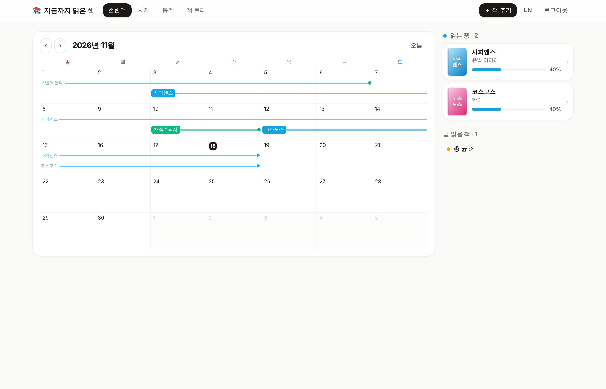
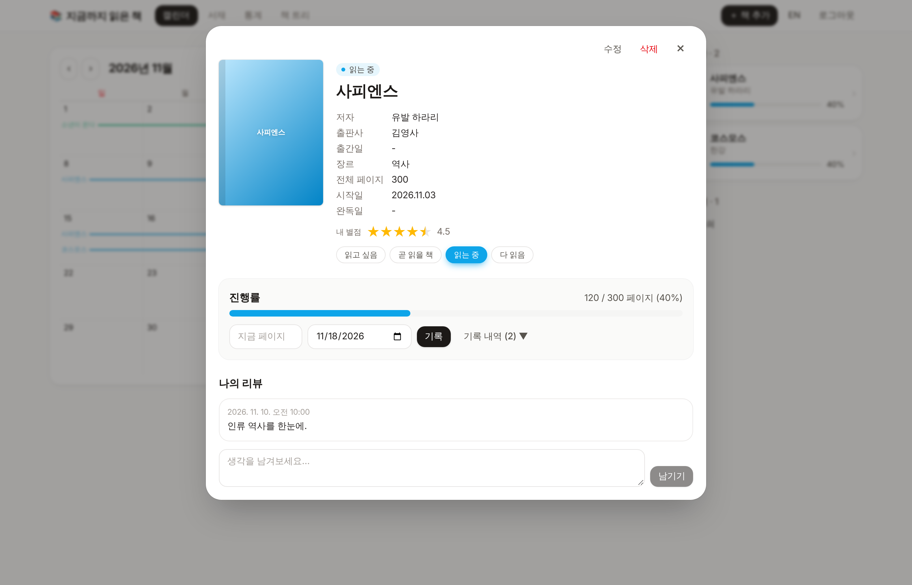
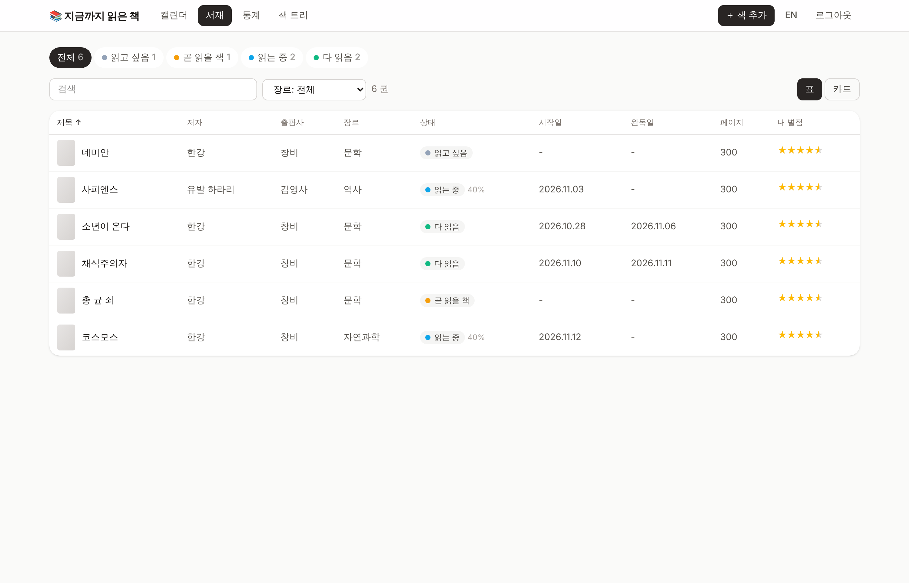
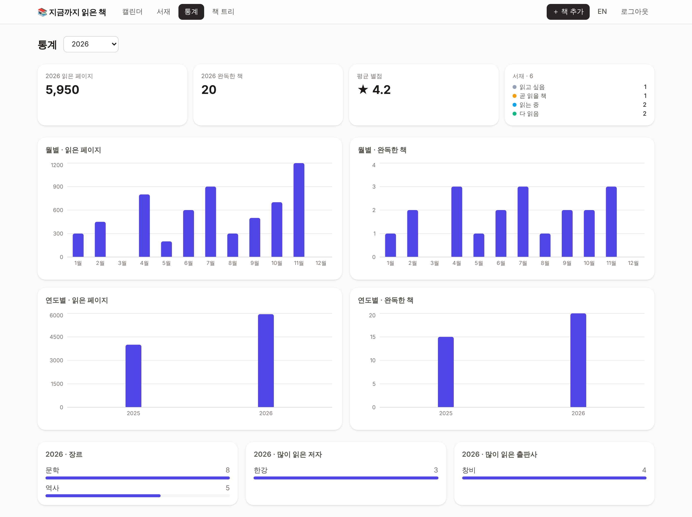
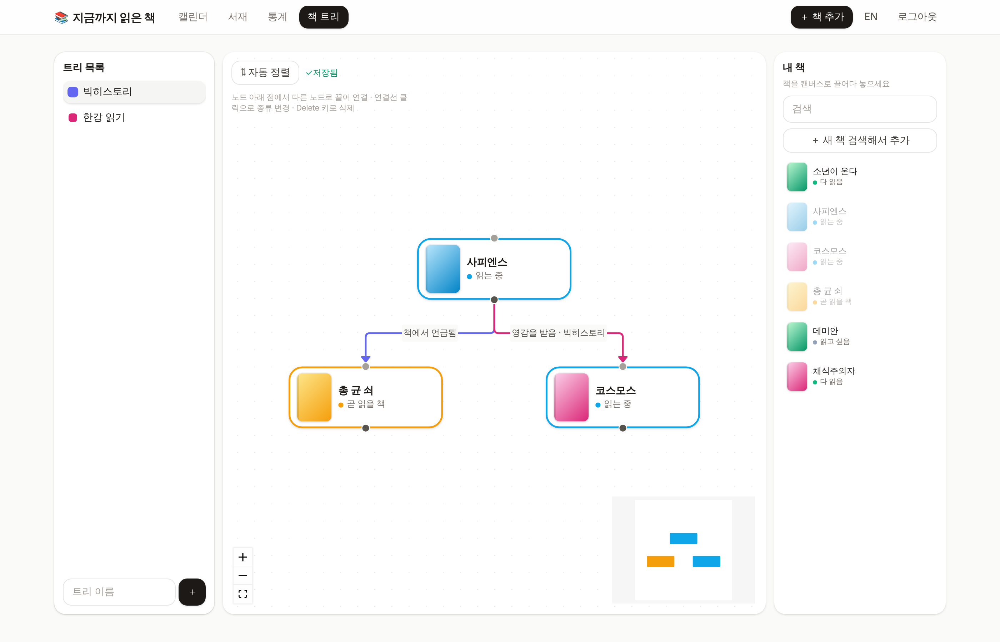
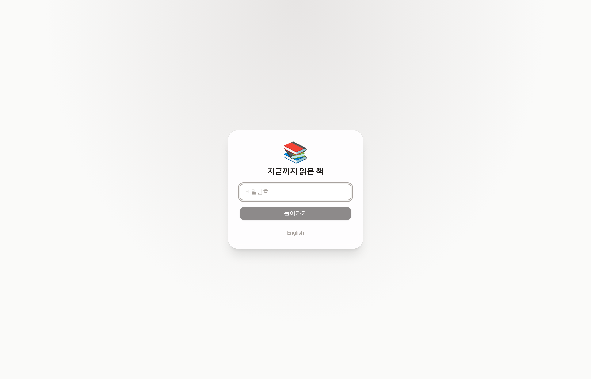

# 지금까지 읽은 책 · What I Read So Far

A personal reading log: calendar of what you're reading, a sortable library, stats, and a
"book tree" mind map of how books led to each other. Korean UI by default, English toggle.

**Stack:** Next.js 16 (App Router) · Tailwind CSS 4 · Supabase (Postgres) · React Flow · Recharts · Vercel

## Pages

| Page | What it does |
|---|---|
| `/login` | Password gate (password = `APP_PASSWORD` env var) |
| `/` Calendar | Month grid. Each book is a small title box on its start date with a line running to its finish date (or to today while reading). Click → detail. |
| `/library` | Want / Soon / Reading / Done tabs, search, genre filter, sort by any column, table or card view |
| `/stats` | Pages read & books finished per month and per year, genres, top writers & publishers |
| `/tree` | Left: your trees (nickname, colour, order). Middle: canvas. Right: your books — drag onto the canvas, connect nodes, set relation (mentioned / inspired / other) and status. Autosaves. |

The **book detail** modal (opened from anywhere) shows the cover, title + subtitle, writers, publisher,
score, status, a progress bar with page logging + history, and a review thread (add/edit/delete many).

All pages share one `books` table, so a status change anywhere shows everywhere.
Statuses: `want` (읽고 싶음) · `soon` (곧 읽을 책) · `reading` (읽는 중) · `done` (다 읽음).

## Book data

"Add book" searches **Kakao Book Search** (title/writer/ISBN → cover, writers, translators, publisher, date),
then looks the ISBN up in the **National Library of Korea ISBN API** (page count, genre from KDC class, subtitle).
Everything is editable; "Enter manually" works without any API.

## Setup

### 1. Supabase
1. Create a project at supabase.com.
2. Dashboard → **SQL Editor** → paste and run [`supabase/schema.sql`](supabase/schema.sql).
3. Dashboard → Project Settings → **API**: copy the Project URL and the `service_role` key.

The service-role key is only used on the server; the browser never talks to Supabase directly,
and row level security is on with no policies, so the public `anon` key can't read anything.

### 2. API keys
- **Kakao**: developers.kakao.com → create app → App Keys → **REST API key**.
- **NLK**: nl.go.kr → 서지정보(ISBN) Open API → request a cert key.

### 3. Environment variables

Keys never go in git. `.env*` is git-ignored (except `.env.example`).

| Name | Value |
|---|---|
| `APP_PASSWORD` | your login password |
| `AUTH_SECRET` | random long string (`openssl rand -hex 32`) for signing the login cookie |
| `SUPABASE_URL` | `https://xxxx.supabase.co` |
| `SUPABASE_SERVICE_ROLE_KEY` | service_role key |
| `KAKAO_REST_API_KEY` | Kakao REST API key |
| `NLK_API_KEY` | NLK cert key (optional — without it, page count/genre are entered by hand) |

- **Local:** `cp .env.example .env.local`, fill it in, then `npm install && npm run dev`.
- **Vercel:** import the repo → Project → Settings → **Environment Variables** → add each one → redeploy.

## Screenshots

| | |
|---|---|
|  |  |
|  |  |
|  |  |
